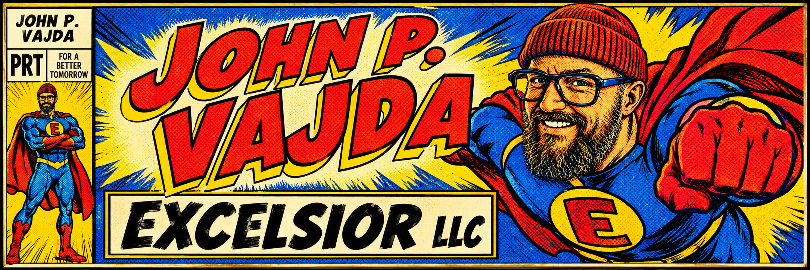

# Excelsior LLC

One-page site for Pain Reprocessing Therapy coaching.

© 2026 Excelsior LLC. All rights reserved. Do not copy, reproduce, or reuse this site, its words, or its images without permission.

## Development

Run it locally from this folder:

```bash
python3 -m http.server 3000
```

Then open http://127.0.0.1:3000.


## Testing

Run the checks:

```bash
pnpm test
```

GitHub runs these on every pull request.

Edit a section in `components/`. Each file is a JavaScript function for that part of the page.

GitHub Pages: Settings → Pages → Deploy from a branch → `main` → `/ (root)`.